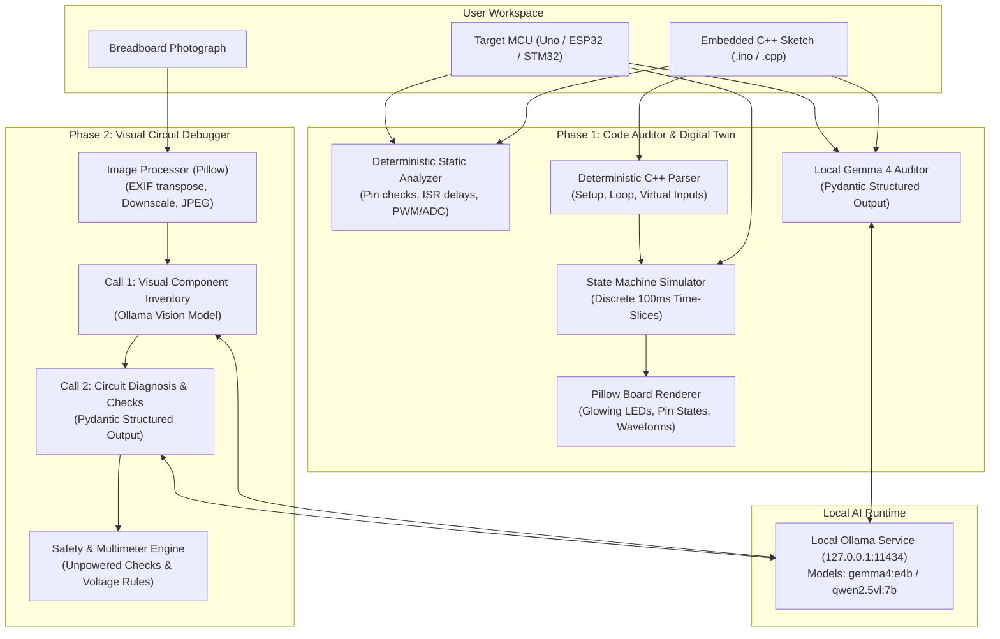

# ⚡ FIRMWARE-ALCHEMIST

> **Offline AI Co-Pilot for Embedded Systems Engineering & Hardware Circuit Debugging**  
> *Developed for Hacktoberfest Hack Day (Team KALKI) — Problem 8: Gemma Track*

---

## 📖 1. Project Overview

**Firmware-Alchemist** is a 100% offline, privacy-first engineering assistant designed for embedded systems developers, robotics engineers, and students working with Arduino, ESP32, and STM32 microcontrollers.

Embedded development is notoriously difficult:
- Firmware bugs can cause real hardware damage (e.g. overcurrent, short circuits, corrupted boot strapping pins).
- Physical testing requires flashing boards, hooking up logic analyzers, and probing breadboard jumpers.
- Proprietary firmware and hardware schematics cannot be uploaded to third-party cloud AI APIs due to IP security and privacy regulations.

**Firmware-Alchemist solves this by bringing a dual-phase AI co-pilot directly to your local workstation:**
1. **Phase 1: Firmware Code Auditor & Deterministic Digital Twin Simulator** — Performs hybrid static analysis and local Gemma 4 reasoning on embedded C++ sketches, paired with a deterministic virtual hardware state-machine that visualizes GPIO logic levels, PWM duty cycles, and glowing LED states across time without executing untrusted code or requiring physical hardware.
2. **Phase 2: Vision-Based Circuit Debugger** — Accepts breadboard photographs and executes a two-step local multimodal vision pipeline (Call 1: Visual Component Inventory $\rightarrow$ Call 2: Contextual Circuit Diagnosis) with safe multimeter verification procedures, interactive checklists, and electrical safety warnings.

---

## 🏗️ 2. System Architecture



---

## 💻 3. Technology Stack

| Layer | Technology | Purpose |
|---|---|---|
| **Frontend & Dashboard** | Streamlit ($\ge$ 1.40) | Dark engineering dashboard, interactive controls, timeline slider |
| **Programming Language** | Python 3.10+ | Clean, modular, type-annotated codebase |
| **Local AI Inference** | Ollama Python SDK | Offline inference on loopback `127.0.0.1:11434` |
| **Primary AI Model** | Gemma 4 E4B (`gemma4:e4b`) | Local structured code auditing and multimodal vision |
| **Optional Vision Fallback**| Qwen2.5-VL 7B (`qwen2.5vl:7b`)| High-resolution vision alternative |
| **Structured Output** | Pydantic v2 | Strict JSON Schema validation (`extra="forbid"`) |
| **Image & Board Graphics** | Pillow ($\ge$ 10) | PCB graphic compositing, waveforms, image preprocessing |
| **Deterministic Simulation**| Python State-Machine | Standalone zero-cloud virtual microcontroller emulator |
| **Resilience & Testing** | Tenacity + Pytest | Exponential backoff retries and 100% passing automated test suite |

---

## ⚡ 4. Hardware Target & Resource Optimization

Designed and optimized for **Apple Silicon (MacBook Pro M4 Pro — 16 GB unified memory)**:
- **Default Model:** `gemma4:e4b` for balanced memory footprint and high reasoning speed.
- **Context Window:** Bounded to 8192 tokens (`num_ctx: 8192`) to prevent unified memory pressure.
- **Zero Memory Leaks:** Uploaded images are preprocessed and downscaled to $\le 1280\text{px}$ preserving aspect ratio.
- **Model Unloading:** The UI includes an **"Unload Model"** action (`keep_alive=0`) to evict the model from RAM when switching to intensive development tasks.
- **Zero Cloud Dependence:** Works with network interface disabled after setup.

---

## 🚀 5. Quickstart & Installation

### Step 1: Install Ollama
On macOS (via Homebrew):
```bash
brew install ollama
```

Start the Ollama local background service:
```bash
ollama serve
```

### Step 2: Pull the Local Models
Pull the primary Gemma 4 model:
```bash
ollama pull gemma4:e4b
```

*(Optional vision fallback model:)*
```bash
ollama pull qwen2.5vl:7b
```

### Step 3: Clone Repository & Setup Virtual Environment
```bash
git clone https://github.com/Amrit42-am/abhimanyu-ai.git
cd abhimanyu-ai

python3 -m venv venv
source venv/bin/activate
pip install -r requirements.txt
```

### Step 4: Run the Application
```bash
streamlit run app.py
```
Open your browser to `http://localhost:8501`.

---

## 🧪 6. Testing & Quality Assurance

Run the automated test suite directly using pytest:
```bash
source venv/bin/activate
python -m pytest tests/ -v
```

The test suite covers:
- **`test_schemas.py`**: Pydantic v2 schema validations, extra-field rejection, and literal bounds.
- **`test_code_parser.py`**: `#define`, `const`, `pinMode`, `digitalWrite`, `analogWrite`, `delay`, control flow, and virtual button input handling.
- **`test_static_analyzer.py`**: Missing `pinMode`, `delay()` inside ISRs, non-PWM `analogWrite`, input-only pin violations, flash-reserved GPIOs, line number grounding, and verdict computation.
- **`test_simulator.py`**: State transitions, duty cycles, virtual button inputs, and deterministic LED hold-state bug reproduction without Ollama.
- **`test_vision_debugger.py`**: Pillow image preprocessing, EXIF orientation correction, dimension bounds, reproducible demo fixture, and electrical safety rule enforcement.
- **`test_llm_client.py`**: Loopback IP security constraints, Ollama connection checks, model availability, and structured JSON parsing.

---

## 🎯 7. Live Demonstration Guide (For Hackathon Judges)

### Demo 1: Phase 1 — Code Auditing & Deterministic Digital Twin
1. Open the application at `http://localhost:8501`.
2. Under **Phase 1**, click **"Load Demo"**. This loads `assets/demo_buggy_sketch.ino`.
3. Point out the expected behavior: *"The LED should illuminate only while the button is pressed."*
4. Click **"🔍 Audit Firmware"**:
   - The deterministic static analyzer flags:
     - **Line 16:** `digitalRead()` called on unconfigured pin `2` (Missing `pinMode` / floating input risk).
     - **Line 23:** Long blocking delay (`1500ms`) freezes MCU polling.
   - The AI Auditor correlates the missing `digitalWrite(LED_PIN, LOW)` with the expected behavior.
   - Overall Verdict: **FAIL — Critical Hardware/Logic Bugs Detected**.
5. Click **"▶️ Run Digital Twin"**:
   - Select **Virtual Button State: LOW (Pressed)**.
   - Move the **Timeline Scrubber** slider from `0ms` to `6000ms`.
   - **Observe the Bug Visually:** The virtual onboard LED on Pin 13 turns bright green at $t = 0\text{ms}$ and **remains permanently illuminated** because the firmware lacks a `LOW` transition!
   - Scrub through the **Logic Waveforms** chart to see the flatline HIGH state.
6. **Key Takeaway for Judges:** The simulator executes deterministically in pure Python without calling any cloud service or executing raw C++ code.

### Demo 2: Phase 2 — Visual Breadboard Debugging & Multimeter Guide
1. Switch to the **"Phase 2: Visual Circuit Debugger"** tab.
2. Click **"Load Demo Fixture"**:
   - Notice the prominent banner: `DEMO FIXTURE — NOT LIVE AI INFERENCE`.
   - The synthetic breadboard graphic displays an ESP32, 5mm Red LED, 220Ω resistor, and a DHT11 sensor.
3. Review **Step 1: Visual Component Inventory**:
   - Shows identified components and terminal locations.
   - Highlights that the 220Ω resistor at Row 20 is unconnected.
4. Review **Step 2: Circuit Diagnosis**:
   - **Finding 1 (High Confidence):** Missing Current-Limiting Resistor on LED. Yellow jumper runs directly from ESP32 GPIO 2 to LED Anode, risking overcurrent damage to the MCU.
   - **Finding 2 (High Confidence):** Missing Pull-Up Resistor on DHT11 single-wire data bus, causing read timeouts.
5. Review the **Safe Multimeter Verification Checklist**:
   - Emphasizes unpowered resistance and continuity measurements (e.g. measuring $\sim 220\Omega$ between Pin 2 and LED Anode).
   - Interactive checkboxes allowing the engineer to verify each step before powering on.
6. Click **"⬇️ Download Diagnostic Report (JSON)"** to export the structured audit.
7. *(Optional live inference)*: When `gemma4:e4b` or `qwen2.5vl:7b` is running in Ollama, click **"🔬 Analyze Circuit"** to demonstrate live two-step vision inference!

---

## 🔒 8. Security & Privacy Guarantees

- **Zero Cloud Leakage:** All inference runs on `127.0.0.1:11434`. No external API keys or cloud dependencies (OpenAI, Anthropic, Gemini Cloud, Hugging Face) exist in the codebase.
- **Loopback Enforcement:** `OllamaClientManager` validates host addresses and explicitly rejects non-loopback endpoints.
- **Safe Static Simulation:** User C++ firmware is parsed deterministically using AST tokenization and balanced brace analysis; **uploaded code is never executed via subprocess or compiled locally**.
- **No Telemetry:** Streamlit telemetry is disabled via `.streamlit/config.toml` (`gatherUsageStats = false`).

---

## ⚠️ 9. Engineering Limitations

1. **Digital Twin Scope:** The simulator models digital state transitions, PWM duty cycles, and discrete timing. It is **not an analog SPICE solver** and does not model component parasitic capacitance, thermal drift, or analog circuit voltages.
2. **C++ Language Subset:** Supports common Arduino constructs (`setup`, `loop`, `pinMode`, `digitalWrite`, `digitalRead`, `analogWrite`, `analogRead`, `delay`, `millis`, simple conditionals, constants, and macros). Complex pointer arithmetic, dynamic allocations, and multi-threaded FreeRTOS tasks are flagged with warnings rather than executed.
3. **Vision Tracing:** Wire tracing accuracy depends on photograph lighting, resolution, and viewing angles. Ambiguous connections are explicitly categorized under `uncertain_connections`.
4. **Mandatory Bench Verification:** All AI diagnoses are advisory and must be verified using the provided unpowered multimeter procedures before applying power.

---

## 🛠️ 10. Troubleshooting

| Issue | Cause | Solution |
|---|---|---|
| `Ollama Offline` indicator | Ollama service is not running | Run `ollama serve` in a terminal. |
| `Model not found` notice | Model hasn't been pulled into Ollama | Run `ollama pull gemma4:e4b` or `ollama pull qwen2.5vl:7b`. |
| Out of memory / Unified RAM pressure | Heavy background processes or large models | Click **"Unload Model"** in the sidebar to release RAM. |
| Image upload rejected | Resolution $< 64\text{px}$ or file $> 15\text{MB}$ | Upload a clear, focused photograph under 15MB. |

---

## 👥 11. Team KALKI
- **Aaryan Sharma** — [GitHub](https://github.com/aaryangif)
- **Harshit Raut** — [GitHub](https://github.com/Harshit10-LM)
- **Amrit Raj** — [GitHub](https://github.com/Amrit42-am)

---

## 📄 12. License
Distributed under the MIT License. See `LICENSE` for details.

